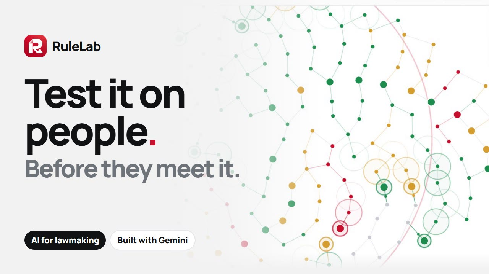
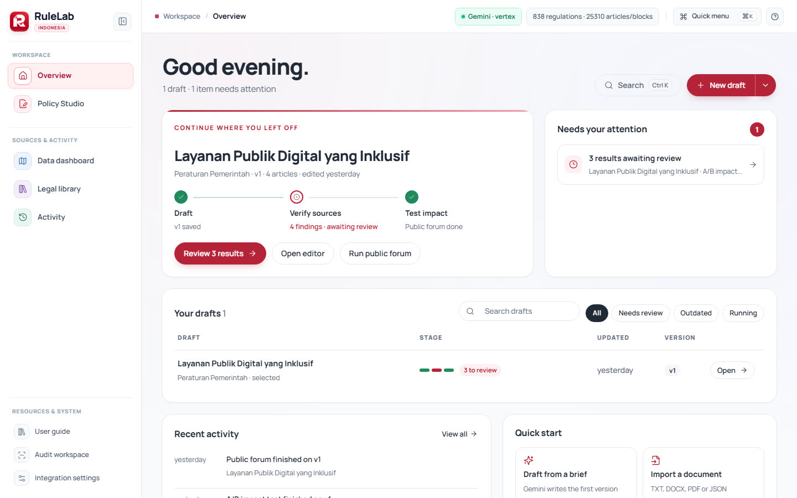
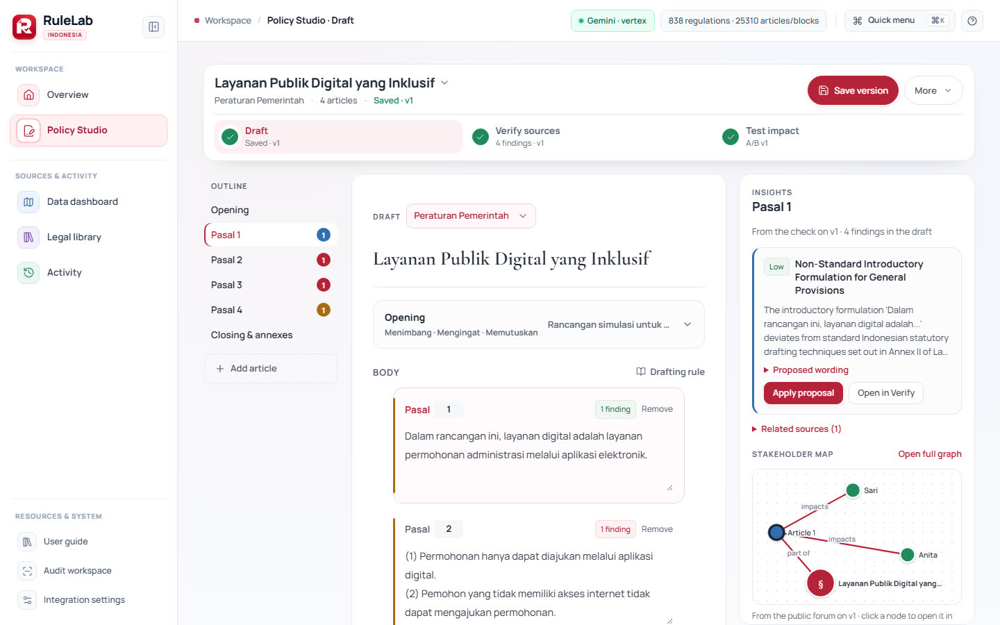
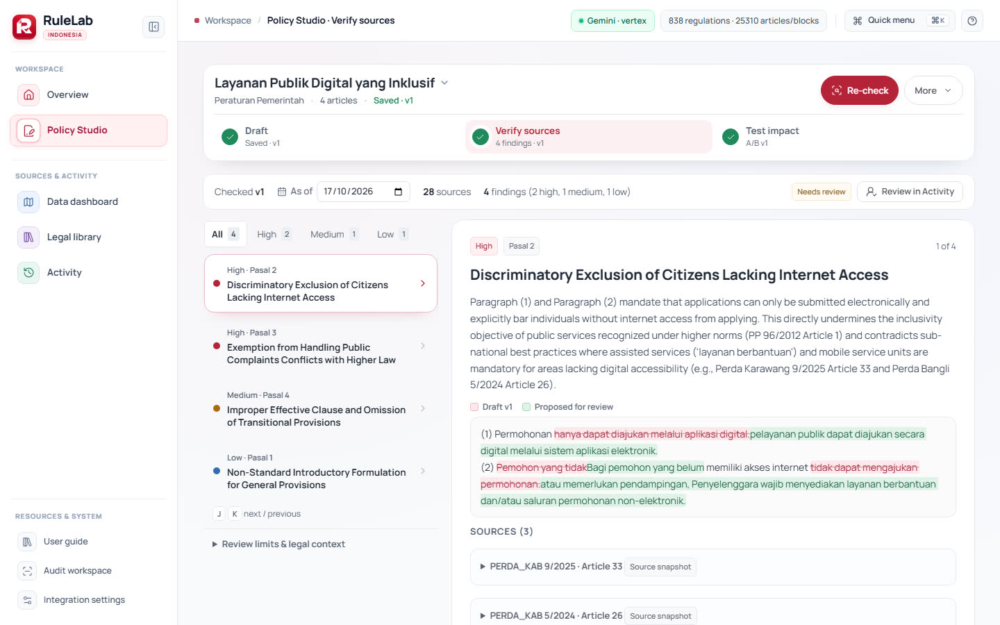
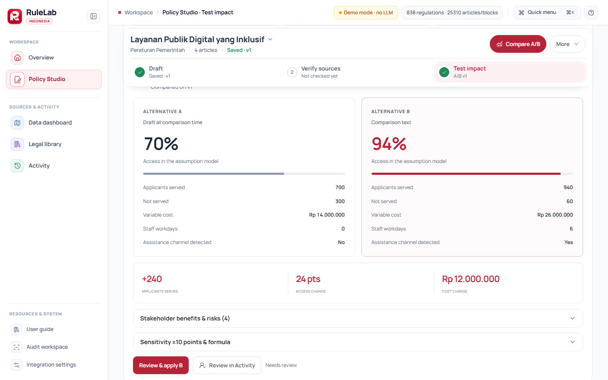
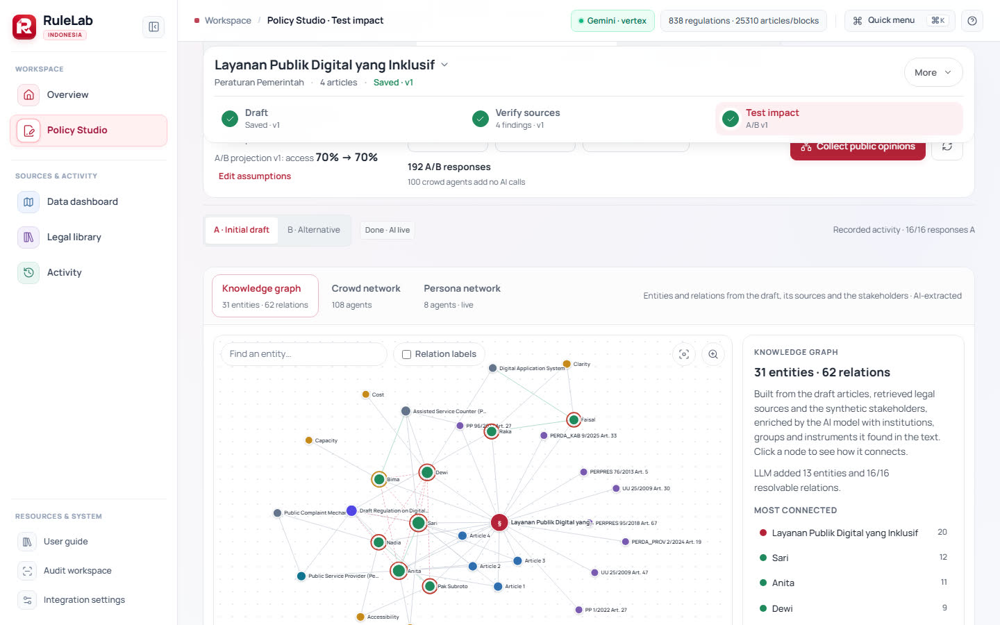
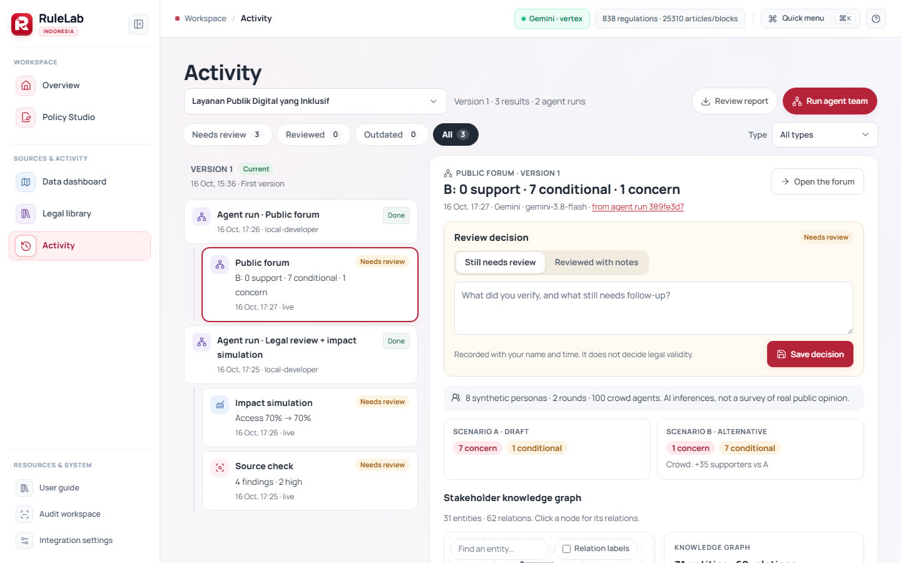
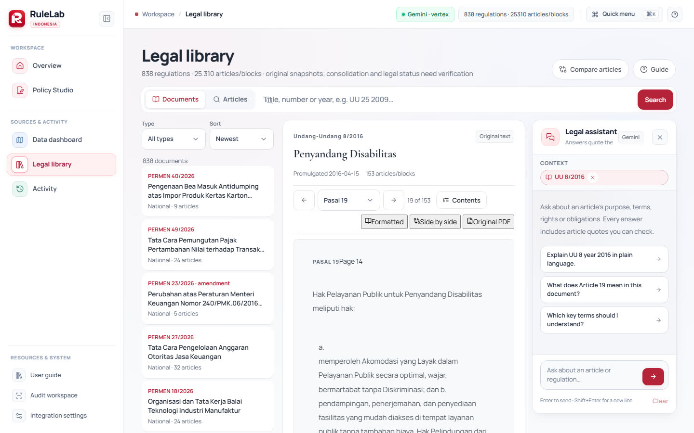
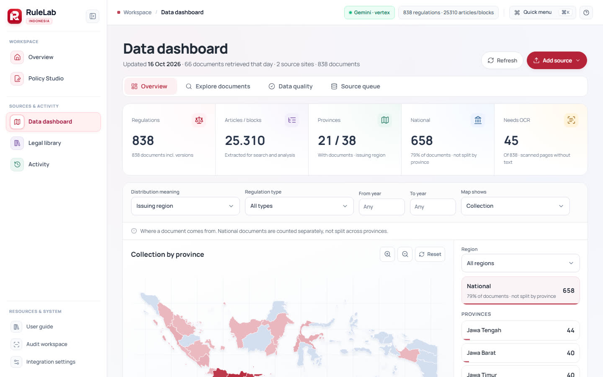
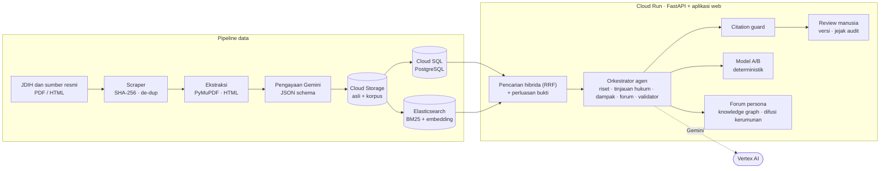

<div align="center">


# RuleLab

**Rancang. Verifikasi. Uji dampak. Sebelum disahkan.**

Workspace AI berbasis Gemini dan Google Cloud untuk menyusun regulasi Indonesia yang berlandaskan hukum resmi dan diuji pada masyarakat sebelum berlaku.

[**▶ Tonton demo 3 menit**](https://youtu.be/d7gLdWj5D4s) · [**Coba aplikasinya**](https://rulelab-627843549213.asia-southeast2.run.app) · [Panduan pengguna](docs/PANDUAN_PENGGUNA.md) · [English](README.md)

[](https://youtu.be/d7gLdWj5D4s)


*Tim RuleLab · AI Builder Cup 2026*

</div>

---

## Mengapa RuleLab

Satu kalimat dalam rancangan regulasi, misalnya *"Permohonan hanya dapat diajukan melalui aplikasi digital"*, bisa menutup akses lansia, penyandang disabilitas, dan desa tanpa sinyal. Perancang mengecek ribuan regulasi yang saling tumpang tindih secara manual, chatbot umum mengarang pasal yang tidak ada, dan dampak nyata pada warga baru terlihat setelah aturan disahkan.

RuleLab menyatukan tiga pemeriksaan dalam satu alur kerja berpusat pada dokumen, dengan reviewer manusia yang memegang kendali atas setiap perubahan.

## Fungsi utama

| Tahap | Yang terjadi | Peran Gemini |
| --- | --- | --- |
| **1 · Rancang** | Jelaskan kebijakan dengan bahasa biasa, atau pilih salah satu dari **15 bentuk regulasi resmi**. RuleLab menyusun naskah dalam struktur hukum (pembukaan, menimbang, dasar hukum, bab dan pasal, penutup). Setiap simpan menjadi versi yang tidak bisa diubah. | Gemini mengubah brief menjadi naskah tervalidasi skema, berlandaskan hukum yang diambil dari korpus. |
| **2 · Periksa sumber** | Pencarian hibrida atas **838 regulasi resmi (25.310 pasal)** memberi bahan bagi agen spesialis yang memeriksa tiap pasal. Setiap temuan menampilkan teks naskah, usulan perbaikan, argumen tandingan, dan sumber persisnya (pasal, halaman, sidik **SHA-256**). Reviewer menerapkan perbaikan sebagai versi baru. | Analisis Gemini terstruktur. **Citation guard** membuang temuan yang kutipan atau ID sumbernya tidak bisa dicocokkan dengan teks sumber. |
| **3 · Uji dampak** | **Model A/B** berbasis asumsi membandingkan naskah A dan B (warga terlayani, yang tertinggal, biaya, beban petugas, sensitivitas ±10 poin), tanpa hitungan oleh LLM. **Forum publik** berisi 8–32 persona sintetis memperdebatkan kedua naskah selama 2–5 ronde, lalu pandangan mereka menyebar lewat kerumunan hingga 500 agen berbasis aturan pada jaringan ikuti. | Gemini memerankan tiap persona dan mengekstrak **knowledge graph** pemangku kepentingan. Agen kerumunan memakai aturan difusi yang transparan dan tidak memanggil AI tambahan. |

Di sekitar studio:

- **Activity**: satu timeline per naskah berisi versi, proses agen, hasil, dan **keputusan review** (siapa, kapan, catatan). Tidak ada yang tertimpa.
- **Legal library**: cari dan baca korpus lengkap dengan snapshot aslinya, plus asisten yang menjawab dengan kutipan yang bisa diverifikasi.
- **Data dashboard**: peta 38 provinsi, penjelajah dokumen dengan filter, pemeriksaan kualitas data, dan antrean masuk untuk sumber baru.
- **Ekspor**: naskah dan laporan review sebagai dokumen Word.

## Tangkapan layar

*Diambil dari deployment live (Gemini di Vertex AI); proyeksi A/B berasal dari mode demo.*

| | |
| --- | --- |
| <br>**Overview**: lanjutkan pekerjaan, hal yang perlu perhatian | <br>**Draft**: outline, naskah, dan panel Insights berisi temuan per pasal |
| <br>**Verify sources**: temuan, diff per kata terhadap usulan, bukti sumber | <br>**Test impact**: proyeksi A/B dari asumsi yang eksplisit |
| <br>**Forum publik**: knowledge graph naskah, sumber, dan pemangku kepentingan | <br>**Activity**: proses, hasil, dan keputusan review yang tercatat |
| <br>**Legal library**: hasil, pembaca, dan asisten berkutipan | <br>**Data dashboard**: cakupan koleksi per provinsi |

## Dibangun di atas Google Cloud

| Layanan | Peran di RuleLab |
| --- | --- |
| **Gemini di Vertex AI** | Penyusunan naskah, agen peninjau hukum, forum persona dan ekstraksi knowledge graph, serta asisten hukum berbasis sumber (keluaran JSON-schema, retry, konkurensi terbatas). |
| **Embedding Vertex AI** (`gemini-embedding-001`, 768 dimensi) | Indeks vektor untuk pencarian hibrida. |
| **Cloud Run** | Melayani backend FastAPI dan aplikasi web, serta menjalankan job agen di latar belakang (CPU selalu aktif). |
| **Cloud SQL for PostgreSQL 16** | Naskah, versi yang tidak bisa diubah, hasil, job dan event agen, keputusan review, audit log, serta korpus regulasi dengan pencarian teks penuh. |
| **Cloud Storage** | Snapshot asli PDF/HTML beserta checksum, dan data lake korpus. |
| **Secret Manager** | Kredensial database dan pencarian; layanan berjalan dengan service account khusus (Application Default Credentials), sehingga tidak ada kunci di dalam image. |
| **Compute Engine** (VPC privat) | Elasticsearch 8 untuk pencarian BM25 + vektor, hanya dapat dijangkau dari dalam VPC. |
| **Cloud Build** | Membangun kontainer langsung dari source saat deploy. |

## Arsitektur



Sisi hukumnya dipandu rulebook terkurasi berisi 28 aturan penyusunan dan konflik (`data/legal/rulebook.json`). Detail di [docs/ARCHITECTURE.md](docs/ARCHITECTURE.md).

**Prinsip rancangan**

- **Bukti atau tidak sama sekali.** Setiap temuan dan jawaban asisten wajib membawa kutipan yang cocok dengan teks sumber yang tersimpan, lengkap dengan halaman dan sidik; selain itu ditolak.
- **Manusia yang memutuskan.** Agen tidak pernah mengubah naskah. Perbaikan diterapkan reviewer sebagai versi baru yang tidak bisa diubah, dan setiap keputusan review tersimpan bersama reviewer, peran, dan waktunya.
- **Angka yang jujur.** Hasil A/B berasal dari asumsi eksplisit dan rumus deterministik; persona sintetis diberi label sebagai inferensi AI, bukan survei.
- **Hasil yang terikat versi.** Sebuah hasil terikat pada versi naskah saat dijalankan dan ditandai usang secara terlihat ketika naskah berubah.

## Mulai cepat

Kebutuhan: Python 3.11+ (disarankan 3.12). Aplikasi web yang sudah dibangun disertakan, sehingga Node.js tidak diperlukan untuk menjalankannya.

```bash
git clone https://github.com/mocharil/RuleLab.git
cd RuleLab

./start.sh --demo      # macOS / Linux: demo lokal, tanpa panggilan Gemini
start.bat              # Windows: tanpa argumen memakai .env (default mode demo)
```

Buka <http://127.0.0.1:8000/workspace>. Mode demo memakai aturan dan templat lokal yang deterministik, dan diberi label demikian di antarmuka.

**Dengan Gemini live di Vertex AI**

```bash
./start.sh --sa "/path/ke/service-account.json"     # Windows: start.bat "C:\path\service-account.json"
```

Lalu buka **Integration settings → Test Gemini connection**. Konfigurasi ada di `.env` (lihat [`.env.example`](.env.example)); variabel `RULELAB_*` yang diset eksplisit lebih diutamakan.

```dotenv
AI_PROVIDER=vertex
GOOGLE_CLOUD_PROJECT=id-proyek-anda
GOOGLE_CLOUD_LOCATION=global
GEMINI_MODEL=gemini-3.8-flash
EMBEDDING_MODEL=gemini-embedding-001
SEARCH_BACKEND=sqlite            # atau elasticsearch
# DATABASE_URL=...               # PostgreSQL / Cloud SQL; default-nya SQLite
```

File service account dan `.env` diabaikan git. Jangan masukkan ke repositori.

## Deploy ke Google Cloud Run

Tata letak produksi (Cloud Run + Cloud SQL + Cloud Storage + Elasticsearch di VM privat) dan semua langkah persiapannya ada di [docs/DEPLOY_CLOUD_RUN.md](docs/DEPLOY_CLOUD_RUN.md). Image hanya berisi kode dan rulebook hukum; korpus berada di Cloud SQL dan Cloud Storage. Pertahankan `--max-instances 1` karena pemulihan job agen saat startup mengasumsikan satu instance.

## Pengujian

```bash
python -m pytest -q tests                  # backend: alur kerja, pencarian, aturan hukum, agen, keamanan, library, activity
npm --prefix frontend test                 # komponen React
npm run test:dom                           # pemeriksaan interaksi DOM
npm run test:studio                        # perjalanan browser: juga test:activity, test:library, test:collection, test:demo, test:forms-network
```

Perjalanan browser berjalan pada database demo sementara. `scripts/verify_live.py --full` menjalankan uji end-to-end berbayar ke Gemini.

## Peta repositori

```
app/            backend FastAPI (main.py = API, services/ = analisis, agen, pencarian, simulasi, sosial, ...)
app/static/     aplikasi web: modul workspace, React islands, gaya, font, geometri provinsi
frontend/       komponen React dan landing page (Vite), dibangun ke app/static
data/           korpus, JSON hasil ekstraksi dan pengayaan, snapshot sumber, rulebook hukum
docs/           arsitektur, deployment, panduan pengguna, catatan strategi dan QA
scripts/        scraping, ingest, indeks, perjalanan browser
tests/          rangkaian pytest
demo/           sumber video demo motion graphics (renderer deterministik)
deploy/         skrip startup VM Elasticsearch
```

## Dokumentasi

- [Panduan pengguna](docs/PANDUAN_PENGGUNA.md) · [User guide (English)](docs/USER_GUIDE.md) · [Panduan hukum](docs/LEGAL_GUIDE.md)
- [Arsitektur](docs/ARCHITECTURE.md) · [Deploy ke Cloud Run](docs/DEPLOY_CLOUD_RUN.md) · [Setup service account](docs/SA_SETUP.md)
- [Simulasi forum publik](docs/SOCIAL_SIMULATION.md) · [Data dashboard](docs/DATA_DASHBOARD.md) · [Kamus data](docs/DATA_DICTIONARY.md)
- Catatan redesain: [Policy Studio](docs/POLICY_STUDIO_REVAMP_STRATEGY.md) · [Data dashboard](docs/DATA_DASHBOARD_REVAMP_STRATEGY.md) · [Legal library](docs/LEGAL_LIBRARY_REVAMP_STRATEGY.md) · [Activity](docs/ACTIVITY_REVAMP_STRATEGY.md)

## Batasan

RuleLab membantu peninjauan; ia tidak menetapkan keabsahan hukum dan tidak menggantikan pendapat hukum. Teks sumber adalah snapshot, bukan peraturan terkonsolidasi yang berlaku, dan perubahan atau putusan pengadilan bisa belum tercermin. Angka A/B berasal dari asumsi pengguna, dan opini persona adalah eksplorasi sintetis: bukan survei dan bukan pengganti konsultasi publik. Setiap hasil membutuhkan review manusia.

## Kredit dan sumber data

Teks hukum: sumber resmi pemerintah Indonesia (JDIH, peraturan.go.id). Geometri provinsi: Badan Informasi Geospasial. Ikon: Lucide (ISC). Font: Manrope dan Cormorant Garamond.
