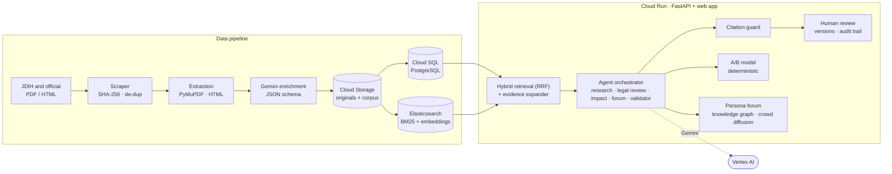

<div align="center">


# RuleLab

**Draft. Verify. Test impact. Before it's signed.**

An AI workspace, built on Gemini and Google Cloud, for drafting Indonesian regulations that are grounded in official law and tested on people before they are enacted.

[**▶ Watch the 3-minute demo**](https://youtu.be/d7gLdWj5D4s) · [**Try the live app**](https://rulelab-627843549213.asia-southeast2.run.app) · [User guide](docs/USER_GUIDE.md) · [Bahasa Indonesia](README.id.md)

[](https://youtu.be/d7gLdWj5D4s)


*Team RuleLab · AI Builder Cup 2026*

</div>

---

## Why RuleLab

One sentence in a draft regulation, such as *"Applications may only be submitted through a digital app"*, can lock out elderly citizens, people with disabilities and villages without a signal. Drafters cross-check thousands of overlapping regulations by hand, generic chatbots invent articles that do not exist, and the real impact on citizens only shows up after the rule is signed.

RuleLab puts three checks in one document-centred workflow, with a human reviewer in control of every change.

## What it does

| Step | What happens | How Gemini is used |
| --- | --- | --- |
| **1 · Draft** | Describe a policy in plain language, or pick one of **15 official regulation forms**. RuleLab builds a draft in the legal structure (opening, considerations, legal basis, chapters and articles, closing). Every save is an immutable version. | Gemini turns the brief into a schema-validated draft grounded in retrieved laws. |
| **2 · Verify sources** | Hybrid retrieval over **838 official regulations (25,310 articles)** feeds specialist agents that check every article. Each finding shows the draft wording, a proposed fix, counter-arguments and the exact source (article, page, **SHA-256** fingerprint). A reviewer applies a fix as a new version. | Structured Gemini analysis. A **citation guard** drops any finding whose quote or source ID cannot be verified against the source text. |
| **3 · Test impact** | An assumption-based **A/B model** compares draft A and B (people served, who is left out, cost, staff workload, ±10 pt sensitivity), with no LLM arithmetic. A **public forum** of 8–32 synthetic personas debates both drafts over 2–5 rounds, and their views spread through a rule-based crowd of up to 500 agents on a follow network. | Gemini plays each persona and extracts the stakeholder **knowledge graph**. Crowd agents follow transparent diffusion rules and make no extra AI calls. |

Around the studio:

- **Activity**: one timeline per draft with versions, agent runs, results and **review decisions** (who, when, notes). Nothing is overwritten.
- **Legal library**: search and read the corpus with original snapshots, plus an assistant that answers with verifiable quotes.
- **Data dashboard**: a 38-province map, an explorer with filters, data-quality checks and an intake queue for new sources.
- **Export**: the draft and the review report as Word documents.

## Screenshots

*Captured from the live deployment (Gemini on Vertex AI); the A/B projection comes from demo mode.*

| | |
| --- | --- |
| <br>**Overview**: continue where you left off, what needs attention | <br>**Draft**: outline, document and Insights rail with findings per article |
| <br>**Verify sources**: findings, word-level diff against the proposal, source evidence | <br>**Test impact**: A/B projection from explicit assumptions |
| <br>**Public forum**: knowledge graph of the draft, its sources and stakeholders | <br>**Activity**: runs, results and recorded review decisions |
| <br>**Legal library**: results, reader and a source-cited assistant | <br>**Data dashboard**: collection coverage by province |

## Built on Google Cloud

| Service | Role in RuleLab |
| --- | --- |
| **Gemini on Vertex AI** | Drafting, specialist legal-review agents, persona forum and knowledge-graph extraction, the source-grounded legal assistant (JSON-schema output, retries, bounded concurrency). |
| **Vertex AI embeddings** (`gemini-embedding-001`, 768-d) | Vector index for hybrid retrieval. |
| **Cloud Run** | Serves the FastAPI backend and the web app, and runs the background agent jobs (always-on CPU). |
| **Cloud SQL for PostgreSQL 16** | Drafts, immutable versions, runs, agent jobs and events, review decisions, audit log, and the regulation corpus with full-text search. |
| **Cloud Storage** | Original PDF/HTML snapshots with checksums, and the corpus data lake. |
| **Secret Manager** | Database and search credentials; the service runs under a dedicated service account (Application Default Credentials), so no keys ship in the image. |
| **Compute Engine** (private VPC) | Elasticsearch 8 for BM25 + vector retrieval, reachable only inside the VPC. |
| **Cloud Build** | Builds the container directly from source on deploy. |

## Architecture



The legal side is guided by a curated rulebook of 28 drafting and conflict rules (`data/legal/rulebook.json`). More in [docs/ARCHITECTURE.md](docs/ARCHITECTURE.md).

**Design principles**

- **Evidence or nothing.** Every finding and every assistant answer must carry a quote that matches the stored source text, with page and fingerprint; anything else is rejected.
- **Humans decide.** Agents never change a draft. Fixes are applied by a reviewer as a new immutable version, and each review decision is stored with reviewer, role and time.
- **Honest numbers.** A/B results come from explicit assumptions and a deterministic formula; synthetic personas are labelled as AI inferences, not a survey.
- **Reproducible runs.** A result is bound to the draft version it ran on, and goes stale visibly when the draft changes.

## Quick start

Requirements: Python 3.11+ (3.12 recommended). The built web app is included, so Node.js is not needed to run it.

```bash
git clone https://github.com/mocharil/RuleLab.git
cd RuleLab

./start.sh --demo      # macOS / Linux: local demo, no Gemini calls
start.bat              # Windows: no arguments uses .env (demo mode by default)
```

Open <http://127.0.0.1:8000/workspace>. Demo mode uses deterministic local rules and templates, and is labelled as such in the UI.

**With live Gemini on Vertex AI**

```bash
./start.sh --sa "/path/to/service-account.json"     # Windows: start.bat "C:\path\to\service-account.json"
```

Then open **Integration settings → Test Gemini connection**. Configuration lives in `.env` (see [`.env.example`](.env.example)); explicitly set `RULELAB_*` variables take precedence.

```dotenv
AI_PROVIDER=vertex
GOOGLE_CLOUD_PROJECT=your-project-id
GOOGLE_CLOUD_LOCATION=global
GEMINI_MODEL=gemini-3.8-flash
EMBEDDING_MODEL=gemini-embedding-001
SEARCH_BACKEND=sqlite            # or elasticsearch
# DATABASE_URL=...               # PostgreSQL / Cloud SQL; SQLite is the default
```

Service-account files and `.env` are git-ignored. Keep them out of the repository.

## Deploy to Google Cloud Run

The production layout (Cloud Run + Cloud SQL + Cloud Storage + Elasticsearch on a private VM) and every setup step are in [docs/DEPLOY_CLOUD_RUN.md](docs/DEPLOY_CLOUD_RUN.md). The image holds only code and the legal rulebook; the corpus lives in Cloud SQL and Cloud Storage. Keep `--max-instances 1`, because agent-job recovery on startup assumes a single instance.

## Tests

```bash
python -m pytest -q tests                  # backend: workflow, retrieval, legal rules, agents, security, library, activity
npm --prefix frontend test                 # React components
npm run test:dom                           # DOM interaction checks
npm run test:studio                        # browser journeys: also test:activity, test:library, test:collection, test:demo, test:forms-network
```

Browser journeys run against a temporary demo database. `scripts/verify_live.py --full` runs a paid end-to-end check against Gemini.

## Repository map

```
app/            FastAPI backend (main.py = API, services/ = analysis, agents, retrieval, simulation, social, ...)
app/static/     web app: workspace modules, React islands, styles, fonts, province geometry
frontend/       React components and landing page (Vite), built into app/static
data/           corpus, extracted and enriched JSON, source snapshots, legal rulebook
docs/           architecture, deployment, user guide, strategy and QA notes
scripts/        scraping, ingestion, indexing, browser journeys
tests/          pytest suite
demo/           source of the motion-graphics demo video (deterministic renderer)
deploy/         Elasticsearch VM startup script
```

## Documentation

- [User guide](docs/USER_GUIDE.md) (also served at `/guide`) · [Legal guide](docs/LEGAL_GUIDE.md)
- [Architecture](docs/ARCHITECTURE.md) · [Deploy to Cloud Run](docs/DEPLOY_CLOUD_RUN.md) · [Service account setup](docs/SA_SETUP.md)
- [Public forum simulation](docs/SOCIAL_SIMULATION.md) · [Data dashboard](docs/DATA_DASHBOARD.md) · [Data dictionary](docs/DATA_DICTIONARY.md)
- Redesign notes: [Policy Studio](docs/POLICY_STUDIO_REVAMP_STRATEGY.md) · [Data dashboard](docs/DATA_DASHBOARD_REVAMP_STRATEGY.md) · [Legal library](docs/LEGAL_LIBRARY_REVAMP_STRATEGY.md) · [Activity](docs/ACTIVITY_REVAMP_STRATEGY.md) (in Indonesian)

## Limits

RuleLab supports review; it does not certify legal validity or replace a legal opinion. Source texts are snapshots, not consolidated law in force, and amendments or court rulings may not be reflected. The A/B numbers come from user assumptions, and persona opinions are synthetic explorations: not a survey and not a substitute for public consultation. Every result needs human review.

## Credits and data sources

Legal texts: official Indonesian government sources (JDIH, peraturan.go.id). Province geometry: Badan Informasi Geospasial. Icons: Lucide (ISC). Fonts: Manrope and Cormorant Garamond.
