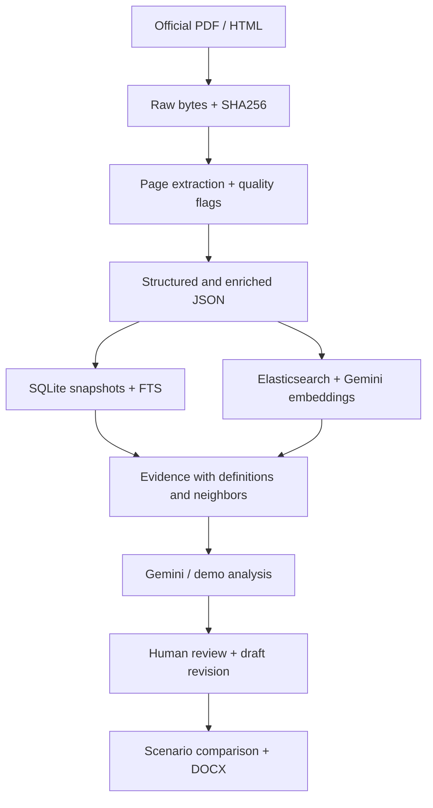

# Architecture and extension boundaries

## Implemented data flow



SQLite is canonical local storage. Elasticsearch is a derivative index. Source byte checksums and content-based version IDs link a retrieved article to a downloaded document. Draft revision IDs are independent of legal corpus versions.

## Modules

| Module | Responsibility |
| --- | --- |
| `app/main.py` | FastAPI routes, validation, auth token, origin guard, imports and downloads |
| `app/models.py` | Pydantic request/output contracts |
| `app/store.py` | Canonical snapshots, FTS5, draft revisions, analysis runs and review notes |
| `app/services/ingestion.py` | Loss-aware extraction, structural parsing and deterministic enrichment |
| `app/services/retrieval.py` | SQLite BM25, Elasticsearch BM25/kNN fusion, neighbor and definition expansion |
| `app/services/ai.py` | Gemini/Vertex authentication, JSON schema, bounded retries and output validation |
| `app/services/analysis.py` | Draft generation, conflict review, citation ID checks and demo rules |
| `app/services/simulation.py` | Assumption model, sensitivity and independent stakeholder perspectives |
| `app/services/export.py` | Draft and review DOCX |
| `app/static/` | Responsive UI without a build system |
| `scripts/scrape.py` | Reproducible official-source corpus creation |
| `scripts/index_elasticsearch.py` | Resumable indexing and embedding cache |
| `scripts/verify_live.py` | Opt-in real Gemini/Vertex/Elasticsearch checks |

## API map

| Endpoint | Purpose |
| --- | --- |
| GET `/api/status` | Provider, corpus counts, search backend; no credentials |
| GET/POST `/api/drafts` | List/create draft |
| GET/PUT `/api/drafts/{id}` | Read/save with expected_revision |
| POST `/api/generate` | Brief → source-grounded initial draft |
| POST `/api/drafts/{id}/analyze` | Immutable analysis tied to draft revision |
| POST `/api/drafts/{id}/apply-revision` | Apply one finding if revision still matches |
| POST `/api/drafts/{id}/simulate` | A/B impact scenario and stakeholder perspectives |
| POST `/api/runs/{id}/review` | Review status and notes |
| GET `/api/drafts/{id}/history` | Draft revisions |
| GET `/api/drafts/{id}/runs` | Analysis/simulation history |
| GET `/api/drafts/{id}/export` | DOCX, report DOCX, JSON |
| POST `/api/import` | Draft TXT/JSON/DOCX/text PDF |
| GET `/api/corpus` and `/api/corpus/{id}` | Corpus metadata and articles |
| GET `/api/corpus/{id}/raw` or `/json` | Original bytes or enriched JSON |
| GET `/api/search?q=...` | Retrieval with source metadata |
| POST `/api/compare` | Two real regulatory articles, selected explicitly |

## Legal version handling

`version_id` combines document ID and SHA256 prefix. `metadata.version_kind` distinguishes original, amended original, and amendment. Replacement articles in amendment documents carry `target_regulation_id`; they are not presented as automatically consolidated current law. Roman Pasal I/II are retained as amendment instruction blocks and must be interpreted in that context.

Citations preserve document SHA256, URL, file and page. Source status and date metadata are not equivalent to full legal validity verification. `current_law_verified` is false. Permen has no fixed automatic rank; authority/delegation requires review.

Next steps for legal-grade temporal retrieval: model effective_from/effective_to per clause, amendment operations, supersession, repeal and court decisions; build consolidated versions through reviewed patches; resolve cross-reference and delegated authority graph; avoid using changed original clauses for an as-of-date claim. This MVP does not implement those legal inferences.

## Simulation model

Input cohort N is split into digital-capable proportion p and the remaining 1−p. If assisted channel is detected, q of the remaining cohort succeeds. These cohorts are mutually exclusive in the arithmetic, so they are not double counted.

- digital served = N × p
- assisted served = N × (1−p) × q
- served = digital + assisted
- variable cost = digital × digital_cost + assisted × assisted_cost
- staff days = assisted / staff_capacity

No empirical calibration, failure cost, capital expense, queue model or uncertainty distribution is included. Stakeholder calls are independent perspectives, not a dynamic agent population exchanging messages. The result explicitly states that it is not MiroFish. To extend: validate personas with real stakeholders, add causal parameters grounded in data, define a simulation horizon, run repeated seeded scenarios, and evaluate outcomes against historical cases.

## Production migration

Keep repository APIs stable when replacing `store.py`. PostgreSQL can store JSONB snapshots and typed columns for identities, source versions, effective dates, relations and audit events. Preserve atomic compare-and-swap on draft revisions (`UPDATE ... WHERE revision = expected_revision`) and immutable analysis runs. PostgreSQL schema below is a migration starting point, not an implemented adapter.

```sql
CREATE TABLE regulation_versions (
 version_id TEXT PRIMARY KEY,
 regulation_id TEXT NOT NULL,
 source_sha256 TEXT NOT NULL,
 retrieved_at TIMESTAMPTZ NOT NULL,
 payload JSONB NOT NULL
);
CREATE TABLE clause_versions (
 id TEXT PRIMARY KEY,
 version_id TEXT REFERENCES regulation_versions(version_id),
 article_number TEXT NOT NULL,
 effective_from DATE,
 effective_to DATE,
 payload JSONB NOT NULL
);
CREATE TABLE regulation_relations (
 source_id TEXT NOT NULL,
 target_id TEXT NOT NULL,
 relation_type TEXT NOT NULL,
 evidence JSONB NOT NULL,
 review_status TEXT NOT NULL DEFAULT 'needs_review'
);
CREATE TABLE drafts (
 id UUID PRIMARY KEY,
 revision INT NOT NULL,
 payload JSONB NOT NULL,
 updated_at TIMESTAMPTZ NOT NULL
);
CREATE TABLE draft_revisions (
 draft_id UUID REFERENCES drafts(id),
 revision INT NOT NULL,
 payload JSONB NOT NULL,
 created_at TIMESTAMPTZ NOT NULL,
 PRIMARY KEY(draft_id, revision)
);
CREATE TABLE analysis_runs (
 id UUID PRIMARY KEY,
 draft_id UUID REFERENCES drafts(id),
 revision INT NOT NULL,
 kind TEXT NOT NULL,
 payload JSONB NOT NULL,
 created_at TIMESTAMPTZ NOT NULL,
 reviewer_id TEXT,
 review_status TEXT NOT NULL DEFAULT 'needs_review',
 review_notes TEXT
);
```

Cloud deployment requires durable DB/object storage, organization authentication, role-based review permissions, job queue for ingestion/LLM, request quotas, provider cost caps and monitoring. The supplied container is packaging, not a claim of production readiness.

## Evaluation priorities

1. Extraction: compare all targeted clauses to original images/HTML; test paragraph boundaries, instructions and annex separation.
2. Retrieval: expert-labeled queries and gold source clauses; Recall@K and relevance across in-force versions.
3. Legal review: evidence correctness, supported conflict rationale, counterargument quality, and false-positive/false-negative cases labeled by qualified reviewers.
4. Simulation: sensitivity, model assumptions and historical calibration, separate from persona writing quality.
5. User flow: correct version binding, stale guard, traceable sources and faithful DOCX content.
