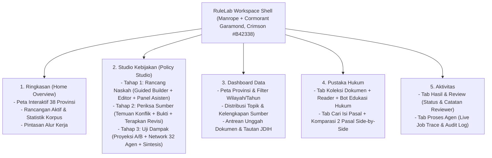
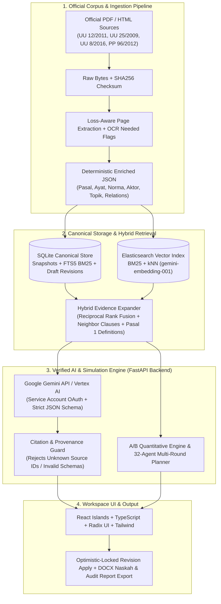

# RuleLab — AI Builder Cup Submission Deck Plan & Content

Dokumen ini berisi rencana *outline* dan draf isi lengkap (*ready-to-copy*) yang dipetakan **1:1 (Slide 1 s.d. Slide 16)** sesuai dengan file template **[Submission Template _ AI Builder Cup (1).pptx](../Submission%20Template%20_%20AI%20Builder%20Cup%20(1).pptx)**.

> **Tips Pengisian:** Karena *heading* di template PowerPoint berbahasa Inggris, setiap slide di bawah ini menyediakan **Teks Siap Copy-Paste (English)** agar selaras dengan judul slide template, diikuti **Versi Bahasa Indonesia / Catatan Visual** untuk memudahkan penyesuaian.

---

## Ringkasan Pemetaan 16 Slide Template

| Slide | Judul di Template PPTX | Fokus Utama Isi untuk RuleLab |
| :---: | :--- | :--- |
| **1** | **Team Details** | Nama tim, ketua tim, dan *Problem Statement* (Disharmoni regulasi & absennya uji dampak pra-pengesahan). |
| **2** | **Template Instruction Note** | *Slide instruksi unduh dari panitia (Hapus sebelum export final PDF/PPTX).* |
| **3** | **Brief about the idea** | Ringkasan eksekutif **RuleLab**: *End-to-end AI Regulatory Drafting, Conflict Review & Impact Simulation Workspace*. |
| **4** | **Opportunities (Diff, How it Solves, USP)** | Perbedaan vs chatbot hukum biasa, cara kerja berbasis bukti (*SHA256-verified RAG*), dan 4 USP utama. |
| **5** | **List of features offered by the solution** | 5 Menu Utama: *Studio Kebijakan* (Draft, Review, Simulasi), *Pustaka Hukum & Bot*, *Dashboard Data 38 Provinsi*, *Aktivitas & Jejak Agen*, *DOCX Interop*. |
| **6** | **Process flow diagram or Use-case diagram** | Diagram alur pengguna (*Policy Maker & Reviewer Journey*) dari penyusunan draf hingga ekspor laporan DOCX. |
| **7** | **Wireframes/Mock diagrams (optional)** | Diagram struktur antarmuka 5-menu & *3-Stage Policy Studio* + referensi gambar *storyboard*. |
| **8** | **Architecture diagram of the proposed solution** | Diagram arsitektur teknis *Ingestion → SQLite/Elasticsearch Hybrid RAG → Gemini/Vertex AI → Human Review*. |
| **9** | **Technologies to be used in the solution** | Python 3.11, FastAPI, Google Gemini API / Vertex AI, `gemini-embedding-001`, SQLite FTS5, Elasticsearch, React + TypeScript + Tailwind + Radix UI. |
| **10** | **Estimated implementation cost (optional)** | Estimasi biaya sangat efisien: *Local-first ($0 infra)* + rincian biaya token Gemini/Vertex per siklus analisis & simulasi 32 agen. |
| **11** | **Snapshots of the prototype** | Panduan 6–8 *screenshot* terbaik dari folder `demo/storyboard/` dan `screenshots/workspace-visual/`. |
| **12** | **Prototype Performance report/Benchmarking** | Bukti pengujian: **104 Backend Tests**, **57 DOM Checks**, **11 Component Tests**, **49 Chromium E2E Journeys**, **406 Pasal Terindeks**, **WCAG Contrast 4.81–14.67:1**. |
| **13** | **Additional Details/Future Development** | Roadmap ke produksi: *JDIH Crawler*, *OCR Lampiran Scan*, *Temporal Legal Graph*, dan *PostgreSQL Multi-Tenant*. |
| **14** | **Links (GitHub, 3-Min Demo Video, Product)** | Placeholder link repositori publik, link video demo (`demo/rulelab-motion-demo-1080p.mp4`), dan cara akses produk. |
| **15** | **Extra / Appendix Slide** | Cadangan untuk lampiran *deep-dive* (mis. Matematika Simulasi A/B atau *Zero-Hallucination Guardrails*). |
| **16** | **Closing Slide** | Slide penutup bawaan template (*Thank You*). |

---

## Detail Isi Per Slide (Siap Copy-Paste)

---

### SLIDE 1: Team Details

* **Team name:** `[Isi Nama Tim Anda, misal: Tim RuleLab]`
* **Team leader name:** `Aril Indra Permana`
* **Problem Statement (English - Ready to Paste):**
  > **Regulatory Hyper-Complexity, Legal Disharmony, and Blind Policy Implementation in Indonesia:**
  > Policy drafters must manually cross-check new regulatory drafts against hundreds of overlapping clauses across primary laws (*UU*), amendment laws (*Pasal I/II*), and implementing regulations (*PP/Permen*). Generic AI chatbots hallucinate legal citations and cannot be trusted for legislative work. Furthermore, regulations are frequently enacted without quantitative service-delivery modeling or multi-stakeholder social impact simulation—causing compliance bottlenecks, budget overruns, and unintended exclusion of vulnerable citizens (such as persons with disabilities) once enforced.

* **Problem Statement (Versi Bahasa Indonesia):**
  > Penyusunan regulasi di Indonesia menghadapi masalah tumpang-tindih aturan (*hyper-regulation*) antara UU induk, UU perubahan, dan aturan pelaksana. Pemeriksaan harmonisasi manual memakan waktu berminggu-minggu dan rawan terlewat, sementara *chatbot* AI umum rawan mengarang pasal (*halusinasi*). Selain itu, kebijakan sering disahkan tanpa simulasi kuantitatif kapasitas layanan publik maupun uji dampak sosial lintas kelompok warga, sehingga masalah baru terlihat setelah aturan diberlakukan.

---

### SLIDE 2: Note Slide (Instruksi Template)
> **Catatan:** Slide 2 pada file asli berisi teks *"Note: Please download this template to make your edits..."*. **Hapus slide ini** saat Anda sudah selesai mengedit agar deck langsung masuk ke Slide 3, atau biarkan jika panitia mewajibkan jumlah halaman tetap.

---

### SLIDE 3: Brief about the idea

* **Copy-Paste Content (English):**
  * **What is RuleLab?**
    **RuleLab** is an end-to-end, AI-powered regulatory drafting, source-verified conflict analysis, and socio-economic impact simulation workspace purpose-built for Indonesian legislation (modeled on **UU 12/2011**, **UU 25/2009**, and **UU 8/2016**).
  * **Core Idea & Workflow:**
    Instead of treating legal drafting, harmonization review, and public impact assessment as disconnected manual tasks, RuleLab unifies them into a single **Policy Studio (*Studio Kebijakan*)**:
    1. **Guided Legal Drafting (*Rancang Naskah*):** Draft regulations using official Indonesian legislative structures (15 regulation types, *Konsiderans*, *Bab/Pasal*, or *Pasal I/II* amendment formats) with immutable version control.
    2. **Zero-Hallucination Conflict Review (*Periksa Sumber*):** Cross-examine every draft clause against an enriched official legal corpus (406 indexed articles/blocks) using Hybrid RAG (BM25 + Gemini Vector Embeddings) where every AI finding is strictly validated against server-side source IDs and SHA256 document checksums.
    3. **Pre-Enactment Impact & Social Simulation (*Uji Dampak*):** Stress-test Draft A vs. Alternative B through a deterministic quantitative service-access/cost model AND a multi-agent synthetic forum (**up to 32 AI personas across 5 interaction rounds = 320 responses**) representing diverse citizens, officials, and vulnerable groups.

* **Visual Pendukung untuk Ditempel di Slide 3:**
  * Gunakan gambar `[02a-reveal-home.png](../demo/storyboard/02a-reveal-home.png)` atau `[02b-reveal-studio-stages.png](../demo/storyboard/02b-reveal-studio-stages.png)`.

---

### SLIDE 4: Opportunities

Slide ini memiliki 3 sub-pertanyaan wajib di dalam template:

#### 1. How different is it from any of the other existing ideas?
* **Generic LLMs / Legal Chatbots:** Standard chatbots generate unverified legal text, hallucinate article numbers, and mix up original laws with amendment blocks (*UU Perubahan*). **RuleLab** enforces strict Pydantic JSON schemas, rejects any citation ID not present in the retrieved evidence set, separates original vs. amendment provisions (`version_kind`), and links every quote to its exact page and SHA256 hash.
* **Static JDIH Portals / Document Repositories:** Existing portals only store PDFs. **RuleLab** transforms static PDFs/HTML into an active drafting workspace with side-by-side clause comparison, inline revision application, quantitative A/B modeling, and multi-agent social simulation.

#### 2. How will it be able to solve the problem?
* **Eliminates Harmonization Blind-Spots:** Automatically detects vertical hierarchy conflicts, missing definitions, and overlapping mandates against existing national laws (e.g., Public Service Law UU 25/2009 & Disability Law UU 8/2016) in seconds.
* **Prevents Policy Failure Before Enactment:** Quantifies digital vs. assisted service coverage, variable costs, and staff workload (±10 pt sensitivity), while exposing hidden social friction through multi-round persona debates before a single regulation is signed.
* **Keeps Humans in Control:** Implements *Optimistic Locking* (`expected_revision`) and immutable audit logs—AI findings are proposals that require explicit human review notes and approval before creating a new draft version.

#### 3. USP (Unique Selling Proposition) of the proposed solution
1. **Cryptographically Grounded Legal AI:** 100% citation verification against official PDF/HTML sources with SHA256 provenance and zero silent fallback.
2. **Indonesian Legislative Domain Native:** Built-in support for 15 official regulation forms (UU, Perppu, PP, Perpres, Permen, Perda, etc.) and Indonesian legal drafting rules (*Lampiran II UU 12/2011*).
3. **32-Agent × 5-Round Policy Simulation Network:** Interactive force-directed opinion graph clustering 320 synthetic citizen/stakeholder reactions across 6 policy issue clusters with instant zero-token replay.
4. **Dual-Engine Offline/Cloud Readiness:** Runs out-of-the-box locally with SQLite FTS5 + deterministic demo mode, and scales seamlessly to Google Gemini API / Vertex AI + Elasticsearch vector hybrid search.

---

### SLIDE 5: List of features offered by the solution

Susun menjadi 5 kartu/poin utama sesuai 5 menu di aplikasi:

1. **Policy Studio (*Studio Kebijakan* — 3-Stage Integrated Workflow):**
   * **Guided Draft Builder:** 15 official regulation templates, AI brief-to-draft generator, focus writing mode, and immutable revision history.
   * **Source-Backed Conflict Analyzer:** Detects norm conflicts, hierarchy issues, counter-arguments, review questions, and one-click safe revision application.
   * **A/B Quantitative & Multi-Agent Simulator:** Compares Draft A vs. Alternative B across citizen access rates, budget costs, staff days, and an interactive **8/16/24/32-agent synthetic citizen forum** (2–5 rounds).
2. **Unified Legal Library & Educational AI Bot (*Pustaka Hukum*):**
   * Full-text and clause-level search across 6 core national regulations (406 articles/blocks), side-by-side real article comparator, raw PDF/HTML + enriched JSON viewer, and a source-verified **Legal Education Bot** for plain-language explanations.
3. **Indonesia 38-Province Regulatory Dashboard (*Dashboard Data*):**
   * Interactive 38-province vector map (BIG geometry), regulatory distribution analytics by type/topic/year, and a source ingestion queue (file upload extraction + SHA256 deduplication + JDIH link queue).
4. **Activity & Agent Operations Center (*Aktivitas*):**
   * Unified human review workflow (`needs_review`, `approved`, `flagged` with reviewer notes) and real-time background AI agent job tracer (`Proses Agen`).
5. **Enterprise Interoperability & Export:**
   * Multi-format import (`.txt`, `.json`, `.docx`, text `.pdf`) and instant export to **formatted Legislative Draft `.docx`**, **Review Report `.docx`**, and structured `.json`.

---

### SLIDE 6: Process flow diagram or Use-case diagram

Anda dapat menyalin diagram alur kerja (*Process Flow*) di bawah ini atau merendernya menjadi gambar untuk dimasukkan ke Slide 6:

```mermaid
flowchart LR
    subgraph Stage1["1. Rancang Naskah (Drafting)"]
        A["Pilih 1 dari 15 Jenis Regulasi / Impor Dokumen / AI Brief"] --> B["Susun Konsiderans & Pasal di Editor (Immutable Revision v1, v2...)"]
    end

    subgraph Stage2["2. Periksa Sumber (Conflict Review)"]
        B --> C["Hybrid RAG Retrieval (BM25 + Gemini Embeddings + Definisi Pasal 1)"]
        C --> D["Analisis Konflik & Hierarki via Gemini / Vertex AI"]
        D --> E["Validasi Skema & Verifikasi ID Kutipan + SHA256"]
    end

    subgraph Stage3["3. Uji Dampak (Simulation)"]
        E --> F["Simulasi Kuantitatif A/B (Akses Digital vs Pendampingan, Biaya, Beban Staf)"]
        F --> G["Simulasi Sosial Multi-Agen (Hingga 32 Persona × 5 Putaran Diskusi)"]
    end

    subgraph Stage4["4. Keputusan & Ekspor (Human-in-the-Loop)"]
        G --> H["Tinjauan Terpadu, Catatan Reviewer & Terapkan Revisi Terpilih"]
        H --> I["Ekspor Naskah Regulasi (.DOCX) & Laporan Audit Review (.DOCX)"]
    end
```

* **Alternatif Gambar Siap Pakai:** Gunakan `[01c-hook-converge.png](../demo/storyboard/01c-hook-converge.png)` dikombinasikan dengan `[02b-reveal-studio-stages.png](../demo/storyboard/02b-reveal-studio-stages.png)`.

---

### SLIDE 7: Wireframes/Mock diagrams of the proposed solution (optional)

Untuk menunjukkan tata letak sistem desain (*Red/White TasteSkill Design System*), tampilkan struktur informasi 5-menu Workspace beserta *wireframe* komponennya:

* **Gambar Pendukung untuk Ditempel di Slide 7:**
  * `[03a0-workflow-guided-builder.png](../demo/storyboard/03a0-workflow-guided-builder.png)` (Modal Guided Builder 15 Jenis Peraturan)
  * `[editor-dropdown.png](../screenshots/workspace-visual/editor-dropdown.png)` (Interaksi komponen dan sistem desain)

---

### SLIDE 8: Architecture diagram of the proposed solution

Berdasarkan dokumentasi resmi di `[docs/ARCHITECTURE.md](ARCHITECTURE.md)`, berikut adalah diagram arsitektur dan modul utamanya:

* **Penjelasan Singkat di Slide 8:**
  * **Canonical Local Store:** SQLite menyimpan *immutable draft revisions*, *analysis runs*, dan *FTS5 index*.
  * **Hybrid RAG:** Menggabungkan pencarian leksikal (BM25) dan semantik (`gemini-embedding-001` 768-dim) via *Reciprocal Rank Fusion (RRF)* plus ekspansi otomatis definisi Pasal 1.
  * **Strict AI Validation:** Respons Gemini/Vertex wajib mematuhi `responseSchema` Pydantic dan seluruh ID rujukan diverifikasi terhadap database sumber.

---

### SLIDE 9: Technologies to be used in the solution

Kelompokkan per *layer* agar mudah dibaca juri:

| Layer | Technologies Used | Purpose in RuleLab |
| :--- | :--- | :--- |
| **AI & LLM Layer** | **Google Gemini API** & **Google Cloud Vertex AI** (`gemini-2.5-flash` / `gemini-2.5-pro`), **`gemini-embedding-001`** (768 dimensions) | Draft generation, legal conflict analysis, plain-language legal education bot, 32-persona multi-round simulation, and semantic vector embeddings. |
| **Backend & API** | **Python 3.11+**, **FastAPI**, **Pydantic v2**, **Uvicorn** | REST API endpoints, strict request/output schema enforcement, optimistic locking, Service Account OAuth token management, and bounded concurrency/retries. |
| **Database & Hybrid RAG** | **SQLite 3 (FTS5 / BM25)**, **Elasticsearch 8 (Dense Vector + BM25)**, **Reciprocal Rank Fusion (RRF)** | Canonical storage for 406 enriched regulatory clauses, immutable draft revisions, review audit trails, and hybrid lexical + vector retrieval. |
| **Frontend & UI** | **React 18 Islands**, **TypeScript**, **Tailwind CSS**, **Radix UI**, **Motion**, **Lucide Icons** | Accessible, responsive workspace (360px–1440px), interactive 38-province SVG map, and force-directed 32-agent opinion network graph. |
| **Document Processing & QA** | **PyPDF / BeautifulSoup4**, **python-docx**, **Playwright (Chromium)**, **Pytest**, **Vitest**, **Docker Compose** | Loss-aware official regulation scraping/ingestion, `.docx` legislative export, containerized deployment, and 200+ automated test checks. |

---

### SLIDE 10: Estimated implementation cost (optional)

Tunjukkan bahwa RuleLab dirancang dengan prinsip **Zero-Cost Local Baseline & Ultra-Low Cloud Marginal Cost**:

#### 1. Infrastructure & Hosting Cost
* **Local / On-Premise Government Workstation Mode:** **$0 / month**
  * Berjalan penuh di komputer lokal menggunakan Python + SQLite FTS5 tanpa biaya lisensi database atau layanan pihak ketiga.
* **Cloud Team Deployment (Optional GCP Cloud Run + Cloud SQL):** **~$15 – $35 / month**
  * Container ringan (`Dockerfile` & `compose.yaml` tersedia) untuk penggunaan tim terpusat di biro hukum instansi.

#### 2. AI Inference & Embedding Cost (Google Gemini / Vertex AI)
* **Initial Corpus Indexing (One-Time for 406 Clauses via `gemini-embedding-001`):** **< $0.05** (dilengkapi *local embedding cache* sehingga tidak perlu bayar ulang).
* **Per Draft Conflict Analysis Run:** **~$0.002 – $0.008 per run** (menggunakan *structured output* dengan *retrieved context* terfokus).
* **Per Multi-Agent Social Simulation (24 Agents × 4 Rounds = 192 Responses):** **~$0.03 – $0.08 per full simulation** (dilengkapi fitur **Instant Replay 1×/2×/4×** yang menggunakan *snapshot* tersimpan tanpa memanggil API LLM ulang).
* **Built-in Cost Controls:** Mode `demo` gratis ($0) untuk pelatihan/pengujian UI, *concurrency limiter*, *token timeout guard*, dan *embedding cache*.

---

### SLIDE 11: Snapshots of the prototype

Pilih **6 hingga 8 gambar resolusi tinggi** yang sudah tersedia di repositori Anda untuk dipasang dalam *grid* di Slide 11 (atau dibagi ke Slide 11 dan Slide 15):

1. **Landing & 38-Province Map:** `[home-1440.png](../screenshots/workspace-visual/home-1440.png)` atau `[02a-reveal-home.png](../demo/storyboard/02a-reveal-home.png)`
2. **Studio Kebijakan — Guided Draft Builder & Editor:** `[03a0-workflow-guided-builder.png](../demo/storyboard/03a0-workflow-guided-builder.png)` & `[03a-workflow-draft-pasal2.png](../demo/storyboard/03a-workflow-draft-pasal2.png)`
3. **Studio Kebijakan — AI Conflict Review & Verified Citations:** `[03b-workflow-review-sources.png](../demo/storyboard/03b-workflow-review-sources.png)`
4. **Studio Kebijakan — A/B Quantitative Impact Simulation:** `[03c-workflow-impact-simulation.png](../demo/storyboard/03c-workflow-impact-simulation.png)`
5. **Studio Kebijakan — 32-Agent Social Network Graph:** `[03c-workflow-network-32-agents.png](../demo/storyboard/03c-workflow-network-32-agents.png)` & `[03c1-network-spreading-clusters.png](../demo/storyboard/03c1-network-spreading-clusters.png)`
6. **Dashboard Data (Peta Regulasi & Statistik Korpus):** `[data-1440.png](../screenshots/workspace-visual/data-1440.png)`
7. **Pustaka Hukum & Bot Edukasi Hukum:** `[gallery-conversation.png](../screenshots/workspace-visual/gallery-conversation.png)` & `[library-passages-1440.png](../screenshots/workspace-visual/library-passages-1440.png)`
8. **Outcome & DOCX Export Package:** `[04-outcome-package.png](../demo/storyboard/04-outcome-package.png)`

---

### SLIDE 12: Prototype Performance report/Benchmarking

Gunakan metrik pengujian aktual dari `[docs/TEST_REPORT.md](TEST_REPORT.md)`, `[docs/HACKATHON_UX_QA.md](HACKATHON_UX_QA.md)`, dan `[docs/FORMS_NETWORK_QA.md](FORMS_NETWORK_QA.md)`:

| Benchmark / QA Category | Measured Metric / Result | Details & Verification |
| :--- | :--- | :--- |
| **Backend Automated Test Suite** | **104 Passed Tests** (`pytest`) | Covers API contracts, optimistic locking, citation verification, Vertex/Gemini OAuth & schema validation, simulation arithmetic, and DOCX generation. |
| **Frontend & DOM Integration** | **57 DOM Checks + 11 Component Tests** | 100% pass rate on state transitions, URL persistence, keyboard accessibility, and form validation. |
| **End-to-End Browser Journeys** | **49 Chromium Playwright Journeys** | 16 Hackathon UX journeys + 33 regression journeys with **0 runtime console errors**. |
| **Responsive Layout Verification** | **5 Breakpoints Tested (360px – 1440px)** | Verified across 360px, 390px, 768px, 1024px, and 1440px viewports across all workspace menus. |
| **Multi-Agent Scale & Throughput** | **Up to 32 Agents × 5 Rounds (320 Responses)** | Tested across 8, 16, 24, and 32 agent configurations across 6 issue clusters with bounded live concurrency and 0-latency cached replay. |
| **Legal Corpus & Accessibility** | **6 National Laws / 406 Indexed Clauses** | Full SHA256 provenance tracking; UI color tokens verified at **4.81:1 to 14.67:1 contrast ratio** (WCAG AA/AAA compliant). |

---

### SLIDE 13: Additional Details/Future Development (if any)

Berdasarkan rencana arsitektur di `[docs/ARCHITECTURE.md](ARCHITECTURE.md)` dan `[docs/DATA_DASHBOARD.md](DATA_DASHBOARD.md)`:

1. **Automated JDIH Crawler & Regional Regulation Expansion (*Perda/Perkada*):**
   * Mengaktifkan *automated crawler* untuk mengambil regulasi dari jaringan JDIH Nasional & 38 Provinsi secara berkala (saat ini antrean tautan JDIH dan *upload* sudah siap di *Dashboard Data*).
2. **Automated OCR Pipeline for Scanned Annexes (*Lampiran Scan*):**
   * Menambahkan pemrosesan *Vision/OCR* terverifikasi untuk halaman lampiran PDF hasil pindaian (yang saat ini sudah ditandai secara otomatis dengan flag `ocr_needed_pages` seperti pada UU 13/2022).
3. **Temporal Legal Knowledge Graph & Auto-Consolidation:**
   * Memodelkan masa berlaku per pasal (`effective_from` / `effective_to`), pencabutan sebagian, putusan uji materi Mahkamah Konstitusi (MK), dan konsolidasi otomatis antara UU Induk dan UU Perubahan.
4. **Enterprise Multi-Tenant PostgreSQL & Role-Based Governance:**
   * Migrasi *canonical store* dari SQLite ke PostgreSQL (`JSONB` + *atomic compare-and-swap*) dengan kontrol akses berbasis peran (*Drafter, Legal Auditor, Supervisor*) serta kalibrasi model simulasi menggunakan data historis empiris instansi.

---

### SLIDE 14: Provide links to your...

Isi tiga baris link pada Slide 14 dengan format berikut:

* **GitHub Public Repository:**
  `[Masukkan URL GitHub Public Repo Anda di sini, misal: https://github.com/username/RuleLab]`
* **Demo Video Link (3 Minutes):**
  `[Masukkan Link YouTube / Google Drive untuk file demo/rulelab-motion-demo-1080p.mp4]`
  *(Catatan: File video 1080p sudah tersedia siap unggah di `[demo/rulelab-motion-demo-1080p.mp4](../demo/rulelab-motion-demo-1080p.mp4)`)*
* **Final Product Link:**
  `[Masukkan Link Cloud Deployment jika di-deploy, atau tulis: Local-First One-Command Workspace (./start.sh | start.bat) + Live Interactive Motion Demo at /demo/index.html]`

---

### SLIDE 15: Extra Slide (Appendix / Deep-Dive Cadangan)

Karena Slide 15 di template kosong (berfungsi sebagai halaman tambahan opsional), Anda bisa menggunakannya untuk salah satu dari dua opsi ini:
* **Opsi A (Visual Showcase Tambahan):** Menampilkan *full-screen comparison* antara tampilan Desktop (`1440px`) dan Mobile (`390px`) serta dialog konfigurasi *Service Account Gemini/Vertex AI* (`[integration-dialog.png](../screenshots/workspace-visual/integration-dialog.png)`).
* **Opsi B (Mathematical & Guardrail Transparency):** Menampilkan rumus eksplisit model simulasi A/B:
  $$\text{Digital Served} = N \times p, \quad \text{Assisted Served} = N \times (1 - p) \times q$$
  $$\text{Variable Cost} = (\text{Digital} \times C_{\text{digital}}) + (\text{Assisted} \times C_{\text{assisted}}), \quad \text{Staff Days} = \frac{\text{Assisted}}{\text{Staff Capacity}}$$
  untuk membuktikan kepada juri bahwa perhitungan dampak kuantitatif bebas dari halusinasi aritmatika LLM.

---

### SLIDE 16: Closing Slide
* Biarkan sesuai desain grafis penutup bawaan template (`image5.png`), atau tambahkan *tagline* kecil di bagian bawah:
  **"RuleLab — Better Regulations, Grounded in Evidence, Tested for Human Impact."**
